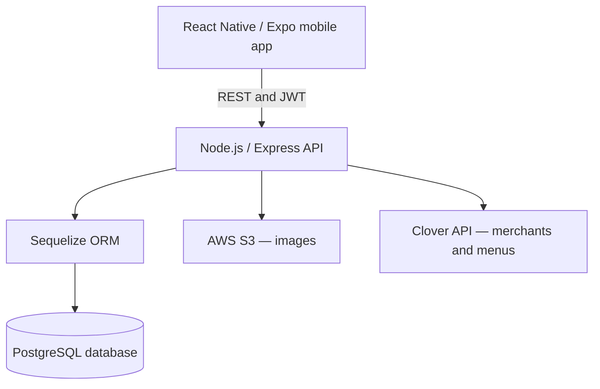

# BrewBuzz Café — Coffee Discovery Mobile App

**Senior Design Capstone · React Native · Expo · TypeScript · Node.js · Express · PostgreSQL**

BrewBuzz Café is a student-developed cross-platform mobile app for discovering local coffee shops, exploring menus, saving favorites, and writing reviews. Business owners can register and manage their shop profiles. The project integrates a React Native frontend with a REST API and PostgreSQL data storage.

> **Portfolio archive:** Educational capstone source, not a live coffee-ordering service. The cleaned project has not been independently validated against live AWS, Clover, or database services.

## Highlights

- Customer registration, login and profile management
- Coffee shop discovery and business details
- Business registration and management
- Menus through Clover integration code
- Favorites, ratings and reviews
- AWS S3 image integration and backend services
- Cart/order-related screens and endpoints (not verified as live checkout)

## My contribution

**Scrum Master and lead frontend contributor** on a four-person team. Responsibilities included task coordination, interface wireframes, frontend development and software quality assurance.

## Architecture



## Tech stack

| Layer | Technologies |
|---|---|
| Mobile | React Native, Expo, TypeScript |
| Backend | Node.js, Express, REST API, JWT |
| Database | PostgreSQL, Sequelize |
| Integrations | AWS S3, Clover |
| Collaboration | Scrum, wireframing, QA |

## Repository layout

```text
frontend/       # React Native/Expo source and assets
backend/        # API routes, models, controllers and services
README.md       # Portfolio overview
SECURITY.md     # Safe publishing notes
```

## Getting started

The original code requires privately configured backend dependencies and authorized services.

1. Run `npm ci` in `backend/` and in `frontend/`.
2. Copy the example environment files to local `.env` files and configure **your own credentials**.
3. Start the backend using its `package.json` scripts.
4. Run `npx expo start` from the frontend folder.

Never commit real secrets or private credentials. Values prefixed `EXPO_PUBLIC_` must not contain secrets.

## Next portfolio improvements

Add screenshots of the actual mobile app, a short demonstration video, and a sanitized senior design report. Features shown in the code have not all been independently regression-tested against currently running services.

**Project owner:** Rama Ksibati · B.S. Computer Information Science
