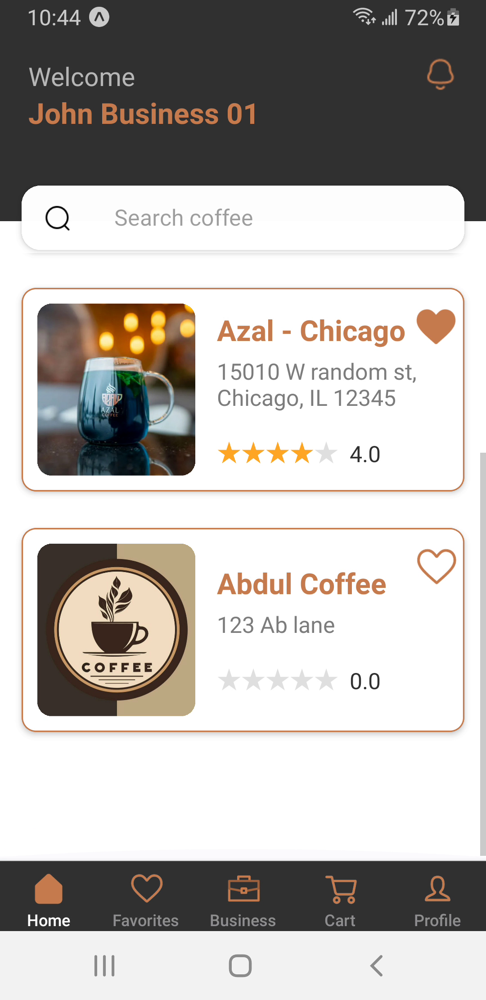
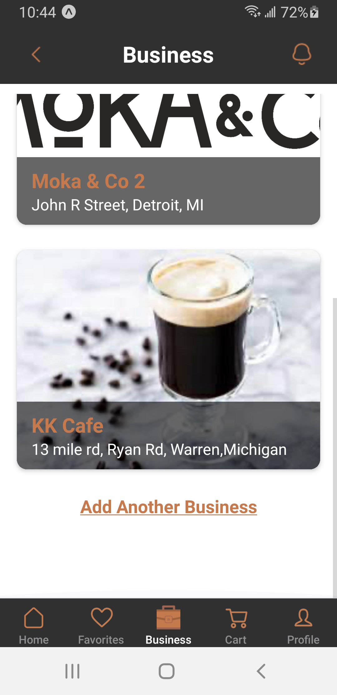
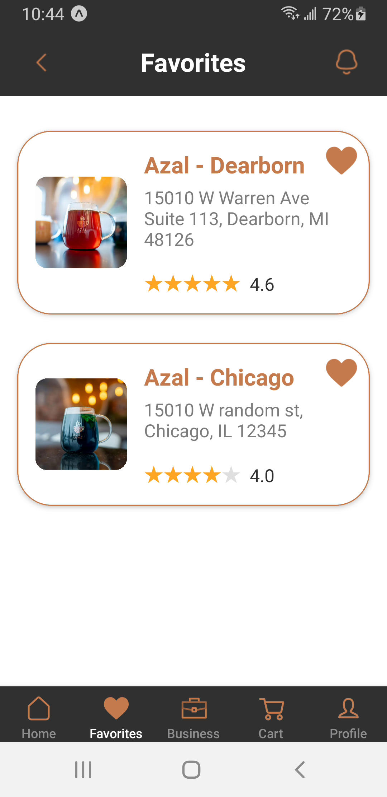
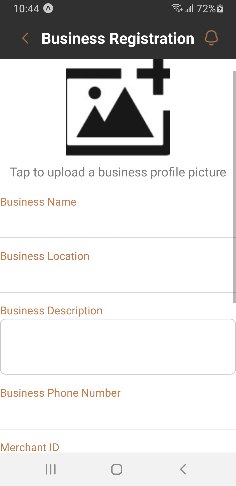
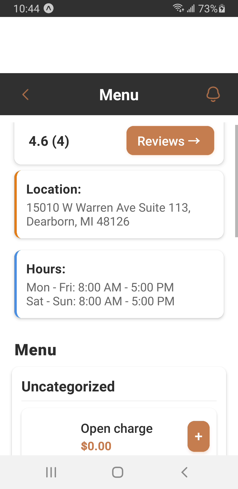
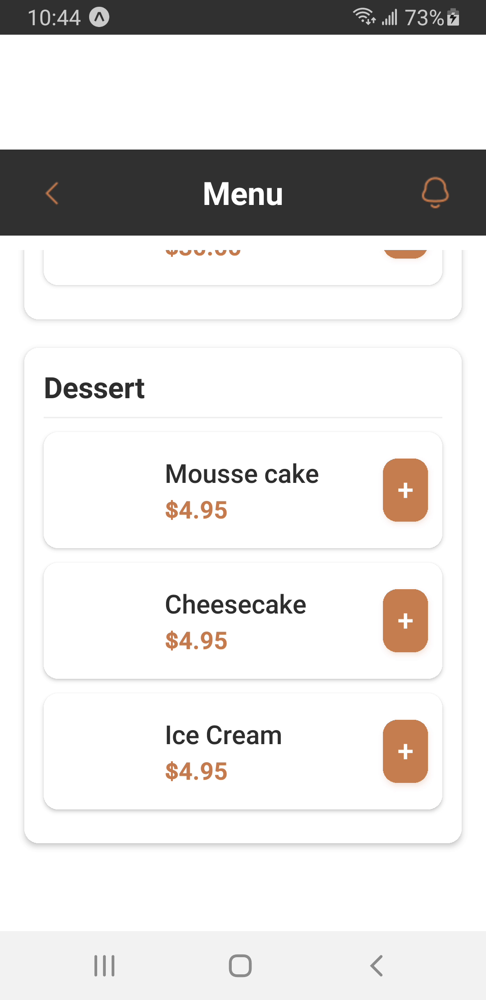
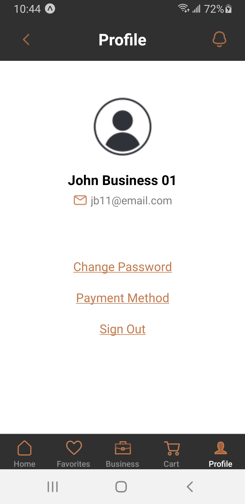
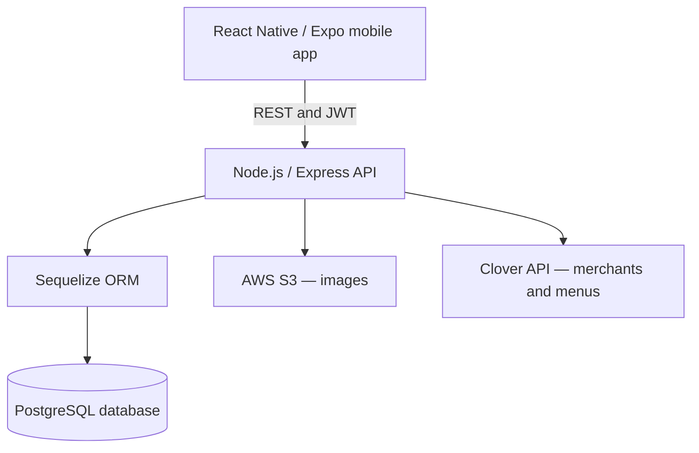

# BrewBuzz Café — Coffee Discovery Mobile App

**Senior Design Capstone · React Native · Expo · TypeScript · Node.js · Express · PostgreSQL**

BrewBuzz Café is a student-developed cross-platform mobile app for discovering local coffee shops, exploring menus, saving favorites, and writing reviews. Business owners can register and manage their shop profiles. The project integrates a React Native frontend with a REST API and PostgreSQL data storage.

> **Portfolio archive:** The cleaned `frontend/` and `backend/` code folders are uploaded. Educational capstone source, not a live coffee-ordering service; current cloud services and end-to-end workflows have not been independently revalidated.

## Highlights

- Customer registration, login and profile management
- Coffee shop discovery and business details
- Business registration and management
- Menus through Clover integration code
- Favorites, ratings and reviews
- AWS S3 image integration and backend services
- Cart/order-related screens and endpoints (not verified as live checkout)

## App showcase

The original Expo screen recording supplied by the team demonstrates the coffee discovery homepage, shop browsing, favorites, business registration, menu browsing, and profile screens. 

| Home | Coffee businesses | Favorites |
|---|---|---|
|  |  |  |

| Business registration | Shop menu | Menu items |
|---|---|---|
|  |  |  |



## Design & documentation

Read the [software design case study](docs/design-case-study.md) for a concise overview of the four-person team's requirements, three-tier architecture, database entity-relationship model, UI mockups, and testing strategy. It is grounded in the original **CIS4952 Software Design Document (39 pages)**.

The original design document remains an academic artifact: proposed ordering, payment, scale, and testing goals are not automatically claims of completed production features. The original DOCX can be uploaded to `docs/` after checking any embedded personal information.

## My contribution

**Scrum Master and lead frontend contributor** on a four-person team. Responsibilities included task coordination, interface wireframes, frontend development and software quality assurance.

## Architecture



## Tech stack

| Layer | Technologies |
|---|---|
| Mobile | React Native, Expo, TypeScript |
| Backend | Node.js, Express, REST API, JWT |
| Database | PostgreSQL, Sequelize |
| Integrations | AWS S3, Clover |
| Collaboration | Scrum, wireframing, QA |

## Repository layout

```text
frontend/       # React Native/Expo source and assets
backend/        # API routes, models, controllers and services
README.md       # Portfolio overview
SECURITY.md     # Safe publishing notes
```

## Getting started

The original code requires privately configured backend dependencies and authorized services.

1. Run `npm ci` in `backend/` and in `frontend/`.
2. Copy the example environment files to local `.env` files and configure **your own credentials**.
3. Start the backend using its `package.json` scripts.
4. Run `npx expo start` from the frontend folder.

Never commit real secrets or private credentials. Values prefixed `EXPO_PUBLIC_` must not contain secrets.


**Project owner:** Rama Ksibati · B.S. Computer Information Science
