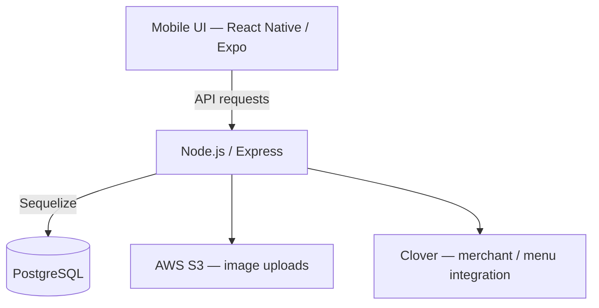

# BrewBuzz — Software Design Case Study

**Source:** *Software Design Document, CIS4952 — BrewBuzz*, authored by Mouaz Chowdhury, Rama Ksibati, Abdulmagid Abdullah, and Ahmed Alomari. This page summarizes the team's design artifact; planned functionality is distinguished from what is visible in the archived source and Expo recording.

## Project motivation

The capstone proposed a mobile-first experience connecting independent cafés with customers. Its requirements cover café discovery, customer accounts, menus, favorites, reviews, and café-owner management. The broader document also proposed future ordering and loyalty capabilities.

## Requirements and UX decisions

The design document describes eight screens: welcome, signup, business registration, sign-in, home, menu, favorites, and profile. The home screen emphasizes discoverability through searchable shop cards, while the owner registration form captures café details. Navigation and clear feedback are recurring UI principles.

The original document contains representative mobile screenshots in **Section 4.1.1, pages 17–26**. These are part of the team's design deliverables, not a claim that all envisioned workflows are production-ready.

## Architecture

The documented three-tier structure separates mobile UI, API/business logic, and persistence:

The design document's **Section 3** discusses component interfaces and alternative architectures. Some language describes a future microservices approach; the archived repository is presented here as a React Native client with an Express backend, **not as independently deployed microservices**.

## Relational data model

**Section 2.4 and the ER diagram on page 11** illustrate planned entities for users, businesses, favorites, reviews, carts, and orders.

- **Users** represent customer and business accounts.
- **Businesses** hold café profiles and ownership information.
- **Favorites** associate accounts with saved cafés.
- **Reviews** associate users, businesses, and ratings.
- **Carts and orders** appear in the design model; do not infer that payment checkout was fully operational from the diagrams.

See the actual Sequelize models in `backend/models/` for the implementation.

## Verification strategy

**Section 6** describes unit, integration, and end-to-end testing plans for authentication, business registration, menus, favorites, reviews, image uploads, and API operations. These are documented **testing goals**, not evidence that every automated test was executed or passed.

## Academic contribution

This is a four-person senior-design project. Rama Ksibati contributed Scrum coordination, frontend work, wireframes, and quality assurance. Credit for the overall design document remains with the four listed authors.

## Portfolio evidence

- [Frontend](../frontend/) and [backend](../backend/) source
- [Main project overview](../README.md)
- Original Expo screen recording (supplied separately)
- Original *Software Design Document* (supplied separately; to be uploaded after privacy review)

**Note:** The team's original design document contains aspirational capabilities and technology mentions. This summary intentionally does not claim that all proposed platforms, third-party tools, performance targets, or release plans were implemented.
